<div align="center">


# PawLife

**El día a día de tu mascota en una sola app: salud, tareas, recordatorios y paseos con mapa.**


**[Português](README.md)** · **Español**

</div>

---

## Sobre el proyecto

**PawLife** es una aplicación móvil hecha en Flutter para quienes cuidan perros y gatos. En lugar de planillas,
libretas de papel y recordatorios sueltos, reúne en un solo lugar el perfil y la salud de cada mascota
(vacunas, medicamentos, peso, consultas), las tareas y los recordatorios del día y el registro de los paseos,
con el recorrido en el mapa y una tarjeta en imagen para compartir.

La app habla con una **API propia en PHP** (repositorio `apipaw`), que guarda los datos en Firestore.
Firebase queda en la app solo para **autenticar** a la persona.

## Funcionalidades

**Mascotas y salud**
- Perfil de cada mascota con foto, especie, raza y fecha de nacimiento.
- Vacunas, medicamentos y otros cuidados, con fechas y recordatorios.
- Historial de peso, con registro y eliminación por fecha.
- Consultas al veterinario.

**Tareas y recordatorios**
- Tareas del día con carrusel en la pantalla de inicio y conteo de las completadas.
- Recordatorios por notificación push (Firebase Cloud Messaging) y notificaciones locales, con acceso directo
  a la pantalla correspondiente.
- Aviso de inactividad y preferencias de notificación controladas por la persona.

**Paseos**
- Registro del recorrido por GPS sobre un mapa de OpenStreetMap: distancia, tiempo y ruta.
- Resumen al final, con foto tomada durante el paseo e historial de todos los paseos.
- **Tarjeta del paseo en PNG** para compartir, en cuatro estilos: *Bosque*, *Menta*, *Cifras* y *Candy*.

**Premium**
- Banner en la pantalla de inicio que lleva a la pantalla de suscripción.
- Plan gratuito con límites (2 mascotas, 5 tareas pendientes, 7 días de historial, 1 estilo de tarjeta);
  Premium lo libera todo. Los límites los aplica el servidor.
- La compra es **simulada** (modo de prueba): no se cobra nada.

**Modo reloj (simulación de smartwatch)**
- Interfaz circular de exactamente 250 × 250 px, fondo negro, sin entrada de texto y con un botón
  principal: iniciar, pausar y terminar el paseo, eligiendo la mascota desde el propio reloj.
- Forma parte de Premium. El código está aislado en `lib/views/wearable/`.

**Privacidad y cuenta**
- Pantalla "Privacidad y mis datos": exportar los datos y eliminar la cuenta.
- Eliminación con varias confirmaciones (casilla de aviso, palabra escrita, espera y nueva autenticación).
- Términos de uso y política de privacidad dentro de la app, escritos con base en la LGPD.
- Cambio de correo con verificación y cambio de contraseña.

**Accesibilidad e idiomas**
- Español, inglés y portugués, con cambio desde el perfil y antes de iniciar sesión.
- Tema claro, oscuro o del sistema, con contraste revisado y respeto por "reducir movimiento".

## Capturas de pantalla

> Las imágenes se generaron a partir de las pantallas reales de la app, renderizadas por la propia suite de
> pruebas con datos de ejemplo (ver [Cómo regenerar las capturas](#cómo-regenerar-las-capturas)). No son de un
> dispositivo físico. Los textos de las capturas están en portugués.

| Bienvenida | Inicio | Mascotas |
| :---: | :---: | :---: |
| 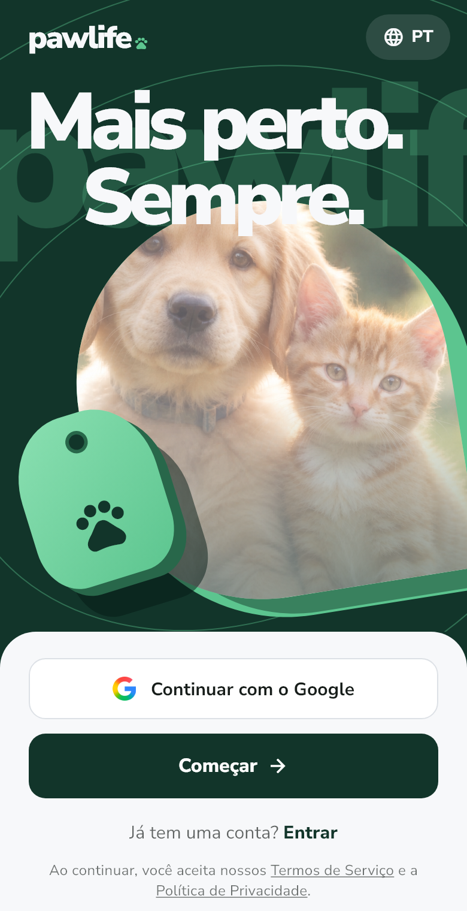 | 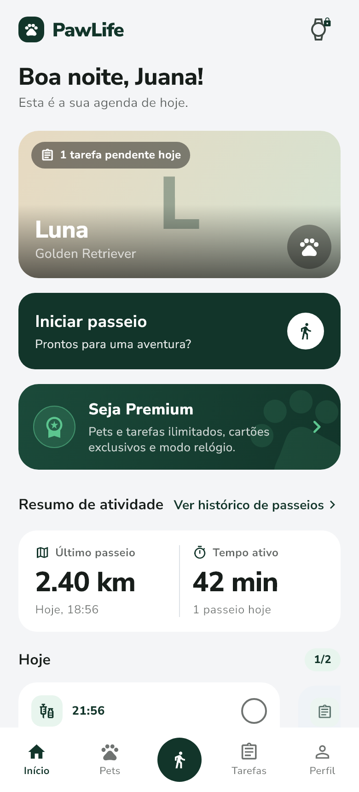 | 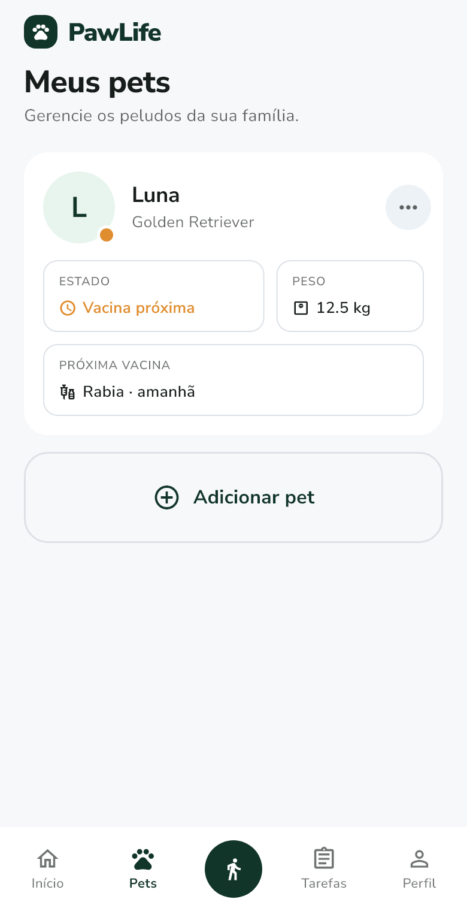 |

| Paseos | Peso | Premium |
| :---: | :---: | :---: |
| 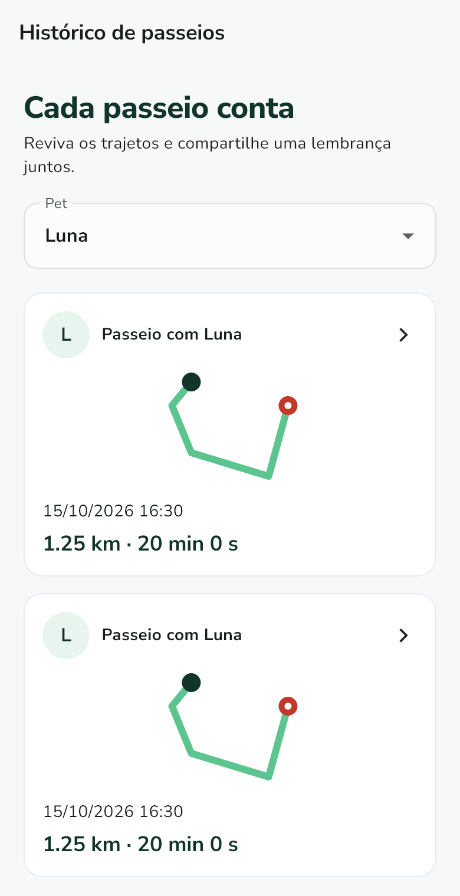 | 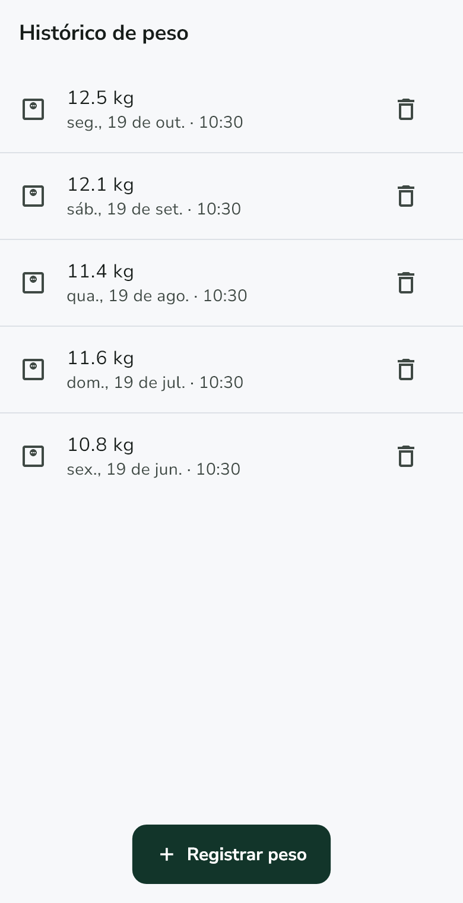 | 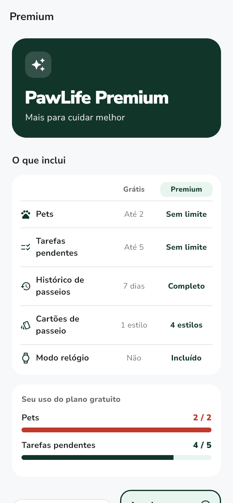 |

**Tarjetas del paseo**

| Bosque | Menta | Cifras | Candy |
| :---: | :---: | :---: | :---: |
| 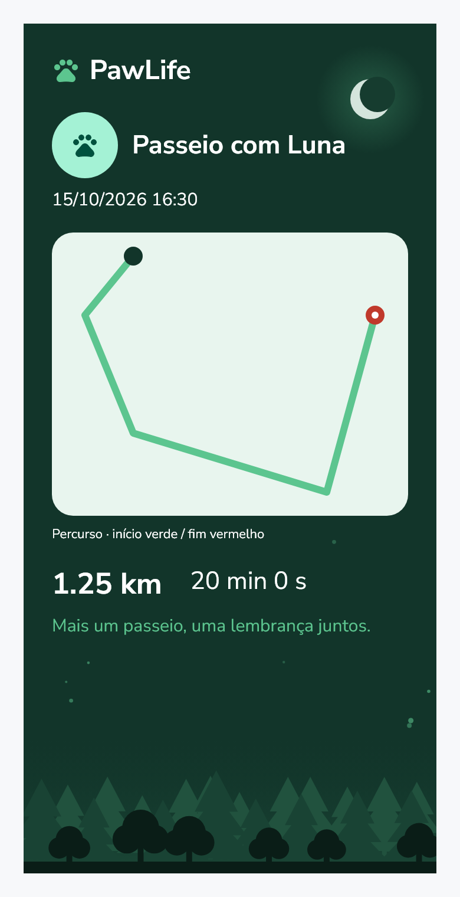 | 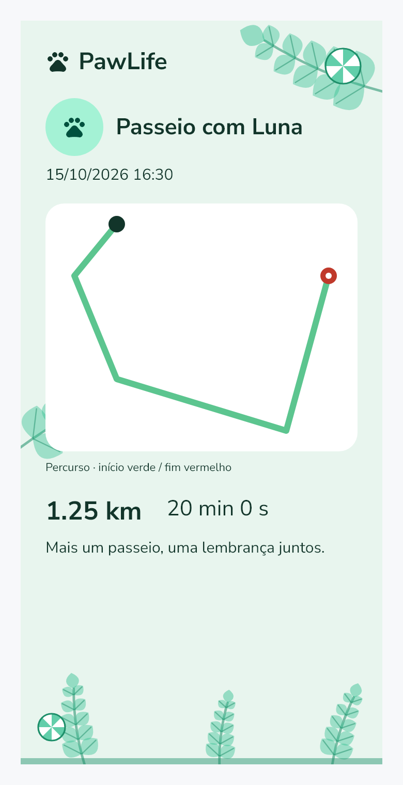 | 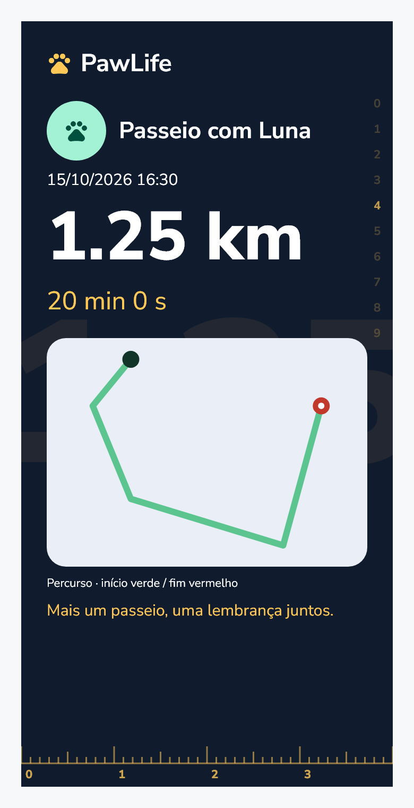 | 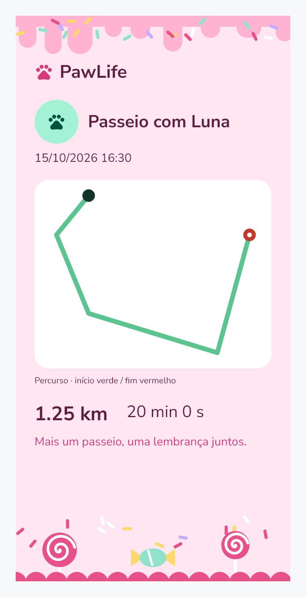 |

**Modo reloj**

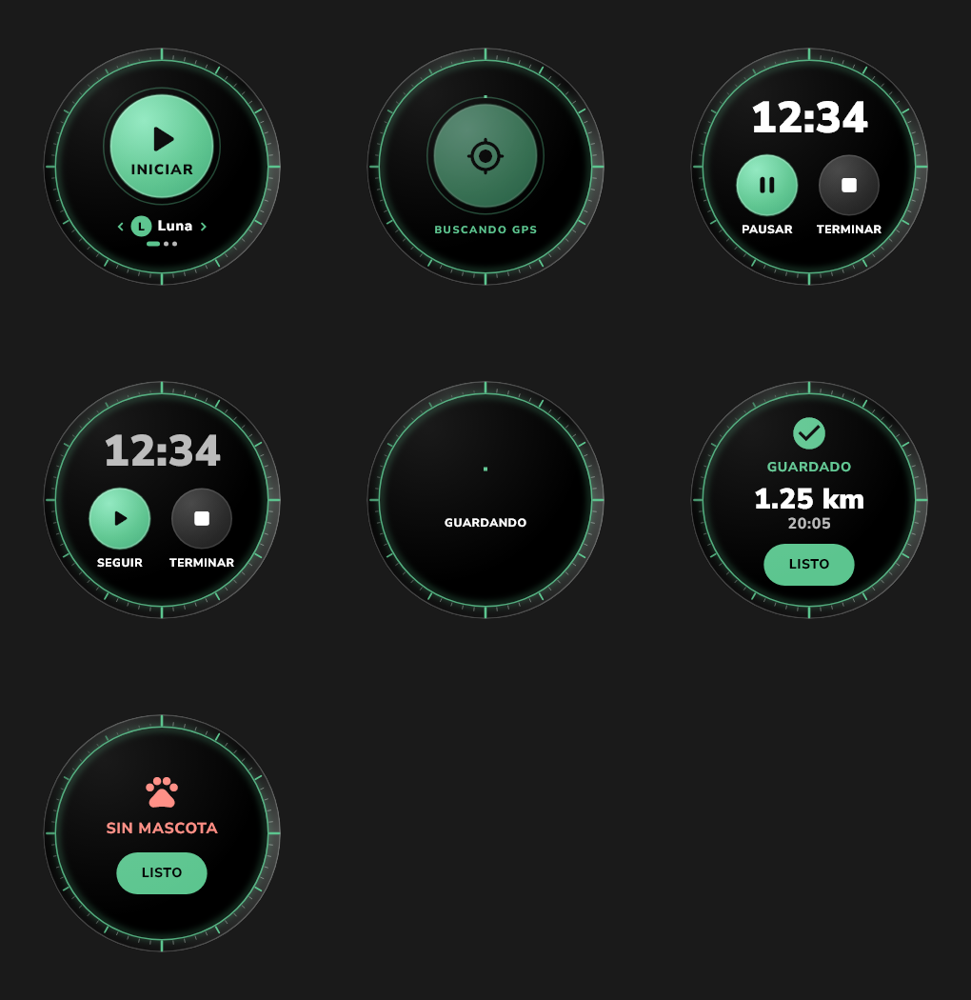

**Selectores de fecha y hora**

| Fecha | Hora |
| :---: | :---: |
| 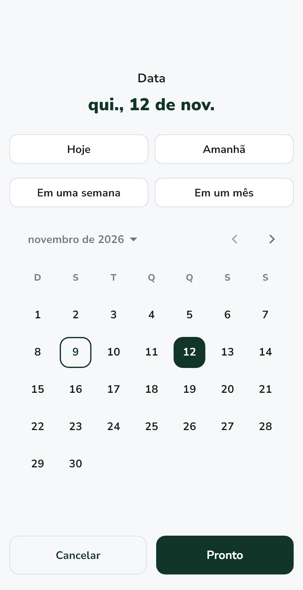 | 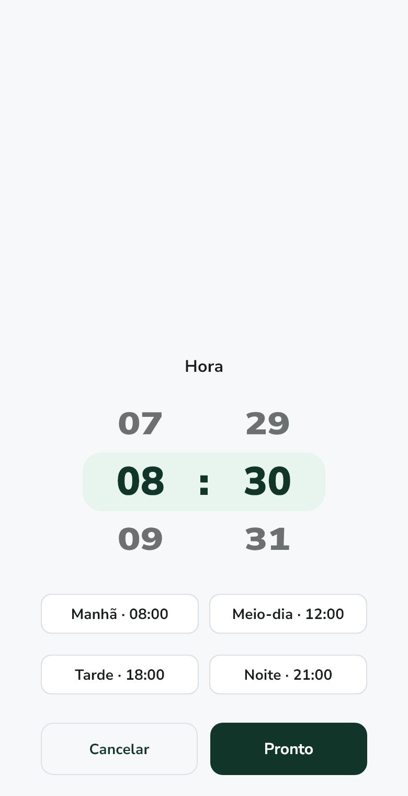 |

## Arquitectura

```
Flutter  ──HTTP + ID token──▶  API PHP (Vercel)  ──REST──▶  Firestore
   │
   └── Firebase Auth (solo para identificar a la persona)
```

La app **no** habla con Firestore. `firebase_auth` emite un ID token, que viaja en cada petición y que el
backend verifica para saber de quién son los datos. En la práctica:

- No agregues `cloud_firestore` de vuelta: los datos se piden a la API.
- Los modelos (`lib/models/pawlife_models.dart`) son Dart puro, con `fromJson`/`toJson` y fechas en ISO 8601.
- No hay streams en tiempo real: donde antes había un `watch…`, ahora hay un `fetch…` que hay que llamar.

### Mapa del código

```
lib/main.dart                         Inicializa Firebase; el AuthGate elige la pantalla raíz.
lib/models/                           Modelos de dominio y el punto de ruta GPS.
lib/services/                         API (api_client), repositorios, autenticación, GPS, push y recordatorios.
lib/viewmodels/route_view_model.dart  Estado del paseo en curso.
lib/views/                            Pantallas. widgets/ tiene los componentes reutilizables.
lib/views/wearable/                   Modo reloj, aislado del resto de la app.
lib/theme/                            Paleta, tema claro/oscuro y componentes visuales.
lib/l10n/                             Textos en es/en/pt (archivos .arb).
test/                                 Pruebas unitarias y de widgets.
tool/                                 Utilidades: generar íconos y la demostración del reloj.
docs/                                 Planes, auditorías, alcance y capturas de pantalla.
```

El inicio de sesión es obligatorio y no existe sesión anónima. El `AuthGate` escucha `authStateChanges`:
muestra la `WelcomeScreen` sin sesión y la `HomeScreen` con sesión. Por eso las pantallas de login y registro
no navegan al Inicio: solo hacen `popUntil(isFirst)` y el gate, que está por debajo, ya se reconstruyó.

## Tecnologías

| Área | Paquetes |
| --- | --- |
| Interfaz | Flutter, Material 3, `provider`, `font_awesome_flutter` |
| Autenticación y push | `firebase_core`, `firebase_auth`, `google_sign_in`, `firebase_messaging` |
| Mapas y GPS | `flutter_map` (OpenStreetMap), `geolocator`, `flutter_foreground_task` |
| Notificaciones locales | `flutter_local_notifications`, `timezone`, `flutter_timezone` |
| Red y datos | `http`, `shared_preferences`, `intl` |
| Fotos y compartir | `image_picker`, `image`, `share_plus` |
| Herramientas de desarrollo | `flutter_launcher_icons`, `flutter_native_splash` |

## Cómo ejecutar

**Requisitos:** Flutter 3.x con Dart `^3.12`, un proyecto de Firebase con Authentication habilitado y el
backend `apipaw` en línea.

```bash
flutter pub get
flutter run --dart-define=PAWLIFE_API_URL=https://tu-proyecto.vercel.app
```

Sin `--dart-define` se usa el valor por defecto de `ApiClient.defaultBaseUrl`
(`lib/services/api_client.dart`). Contra un backend local (`php -S localhost:8000 api/index.php` dentro de
`../apipaw`), ojo: `localhost` dentro del emulador de Android es el propio emulador:

```bash
# Android (emulador)
flutter run --dart-define=PAWLIFE_API_URL=http://10.0.2.2:8000
# iOS (simulador)
flutter run --dart-define=PAWLIFE_API_URL=http://localhost:8000
```

Hablar con un backend local por HTTP sin TLS exige permitir tráfico en claro en el `AndroidManifest.xml` de
debug. En producción la URL es https y no hace falta.

### Configuración de Firebase y Google Sign-In

Sin estos pasos el acceso falla, y el código no puede suplirlo:

1. **Firebase Console → Authentication → Sign-in method:** habilitar *Correo electrónico/contraseña* y *Google*.
2. **Configuración del proyecto → Tus apps → Android → Agregar huella digital:** la SHA-1 de la máquina que
   compila.

   ```bash
   keytool -list -v -keystore ~/.android/debug.keystore \
           -alias androiddebugkey -storepass android -keypass android
   ```

   En Windows, si `keytool` falla con `MissingFormatArgumentException`, agregá
   `-J-Duser.language=en -J-Duser.country=US`.
3. **Volver a descargar `google-services.json`** y reemplazar el de `android/app/`. Mientras la SHA-1 no esté
   registrada, el archivo trae `"oauth_client": []` y Google Sign-In falla con `ApiException: 10`. El archivo
   correcto tiene una entrada con `"client_type": 3`; si no la tiene, se puede pasar el cliente web a mano:

   ```bash
   flutter run --dart-define=GOOGLE_SERVER_CLIENT_ID=<web client id>
   ```

Cada máquina de debug y la clave de release tienen su propia SHA-1: hay que registrarlas todas. En **iOS**
también hacen falta `GoogleService-Info.plist` en `ios/Runner/` y el `CFBundleURLSchemes` con el
`REVERSED_CLIENT_ID` en `Info.plist`.

### Ícono y pantalla de carga nativa

Las imágenes salen de `assets/icon/` (generadas por `tool/gerar_icones_test.dart`) y se aplican con:

```bash
flutter test tool/gerar_icones_test.dart   # solo si cambia el diseño de la marca
dart run flutter_launcher_icons            # íconos de Android e iOS
dart run flutter_native_splash:create      # pantalla de carga nativa
```

## Pruebas

```bash
flutter analyze
flutter test
```

La suite tiene más de 170 pruebas (modelos, servicios, pantallas, accesibilidad, idiomas, responsividad y el
modo reloj). Todas usan datos simulados: **no reemplazan** la prueba en un dispositivo físico ni contra el
Firebase real.

### Cómo regenerar las capturas

```bash
PAWLIFE_SCREENSHOTS=1 flutter test test/gallery_test.dart
```

Cada pantalla se guarda en `docs/screenshots/` (portugués, tema claro). Las grillas completas, en tres idiomas
y dos temas, salen en `build/test-artifacts/`.

### Demostración del modo reloj

Para ver el reloj animado en el navegador, sin sesión ni GPS (el paseo es simulado):

```bash
flutter run -d web-server --web-port 5006 -t tool/demo_reloj.dart
```

## Fotos de las mascotas

No hace falta ningún servicio extra: la app reduce la foto a 256 px, la codifica en base64 y la guarda como
data URI en el campo `fotoUrl` del documento de la mascota (`lib/services/photo_service.dart`). Unas decenas
de KB, muy por debajo del límite de 1 MB por documento. No se usa Firebase Storage porque exige el plan Blaze
en proyectos nuevos. La foto viaja en cada carga del listado, por eso el tamaño importa.

## Estado

Funciona y está cubierto por pruebas locales, pero todavía **falta**:

- Probar GPS, cámara, notificaciones push en primer y segundo plano y el reloj en un **dispositivo físico**.
- Validar contra el Firebase real (envío del correo de verificación, eliminación completa de la cuenta,
  índices y permisos).
- Cambiar el identificador de la app (`com.example.flutter_application_1`) por el definitivo antes de
  publicar en las tiendas; también es el nombre con el que la app pide el mapa a OpenStreetMap.
- Revisión jurídica de los términos y de la política de privacidad.
- Pagos reales: hoy la suscripción es una simulación.

## Documentación

- [Cierre de la entrega](docs/CIERRE_ENTREGA.md) — funciones, pruebas y pendientes.
- [Alcance del proyecto semestral](docs/ESCOPO_PROJETO_SEMESTRAL.md) (en portugués)
- [Plan de pendientes y reloj](docs/PLAN_PENDIENTES_Y_RELOJ.md)
- [Plan social de los paseos](docs/PLAN_SOCIAL_PASEOS.md)
- El panel administrativo (notificaciones y Premium manual) está en la API: `https://apipaw.vercel.app/notificaciones`,
  y exige una cuenta administradora habilitada en el backend.
