<div align="center">


# PawLife

**O dia a dia do seu pet em um só app: saúde, tarefas, lembretes e passeios com mapa.**


**Português** · **[Español](README.es.md)**

</div>

---

## Sobre o projeto

O **PawLife** é um aplicativo móvel feito em Flutter para tutores de cães e gatos. Em vez de planilhas,
cadernetas de papel e lembretes soltos, ele reúne em um só lugar o perfil e a saúde de cada pet
(vacinas, medicamentos, peso, consultas), as tarefas e os lembretes do dia e o registro dos passeios, com
trajeto no mapa e um cartão em imagem para compartilhar.

O aplicativo conversa com uma **API própria em PHP** (repositório `apipaw`), que guarda os dados no
Firestore. O Firebase fica no app apenas para **autenticar** a pessoa.

## Funcionalidades

**Pets e saúde**
- Perfil de cada pet com foto, espécie, raça e data de nascimento.
- Vacinas, medicamentos e outros cuidados, com datas e lembretes.
- Histórico de peso, com registro e exclusão por data.
- Consultas ao veterinário.

**Tarefas e lembretes**
- Tarefas do dia com carrossel na tela inicial e contagem das concluídas.
- Lembretes por notificação push (Firebase Cloud Messaging) e notificações locais, com atalho direto
  para a tela correspondente.
- Aviso de inatividade e preferências de notificação controladas pela pessoa.

**Passeios**
- Gravação do trajeto por GPS sobre mapa do OpenStreetMap: distância, tempo e rota.
- Resumo ao final, com foto durante o passeio e histórico de todos os passeios.
- **Cartão do passeio em PNG** para compartilhar, em quatro estilos: *Bosque*, *Menta*, *Cifras* e *Candy*.

**Premium**
- Banner na tela inicial que leva à tela de assinatura.
- Plano gratuito com limites (2 pets, 5 tarefas pendentes, 7 dias de histórico, 1 estilo de cartão);
  Premium libera tudo. Os limites são aplicados pelo servidor.
- A compra é **simulada** (modo de teste): nada é cobrado.

**Modo relógio (simulação de smartwatch)**
- Interface circular de exatamente 250 × 250 px, fundo preto, sem entrada de texto e com um botão
  principal: iniciar, pausar e terminar o passeio, escolhendo o pet pelo próprio relógio.
- Faz parte do Premium. O código fica isolado em `lib/views/wearable/`.

**Privacidade e conta**
- Tela "Privacidade e meus dados": exportar os dados e excluir a conta.
- Exclusão com várias confirmações (caixa de aviso, palavra digitada, espera e nova autenticação).
- Termos de uso e política de privacidade dentro do app, escritos com base na LGPD.
- Troca de e-mail com verificação e troca de senha.

**Acessibilidade e idiomas**
- Espanhol, inglês e português, com troca no perfil e antes do login.
- Tema claro, escuro ou do sistema, com contraste revisado e respeito a "reduzir movimento".

## Capturas de tela

> As imagens foram geradas a partir das telas reais do app, renderizadas pela própria suíte de testes
> com dados de exemplo (veja [Como regenerar as capturas](#como-regenerar-as-capturas)). Não são de um
> dispositivo físico.

| Boas-vindas | Início | Pets |
| :---: | :---: | :---: |
| 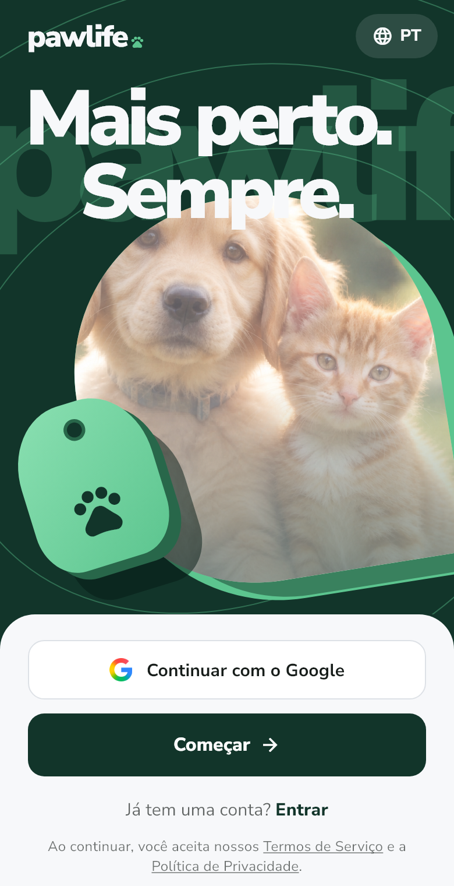 | 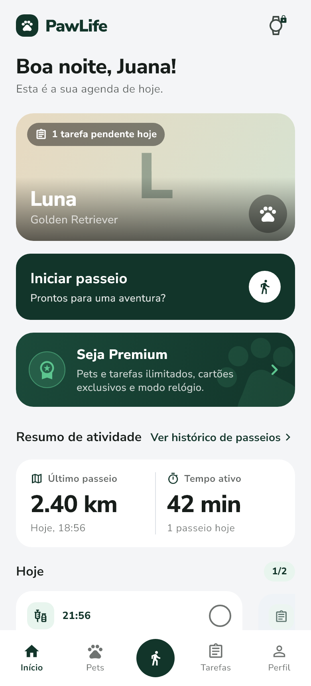 | 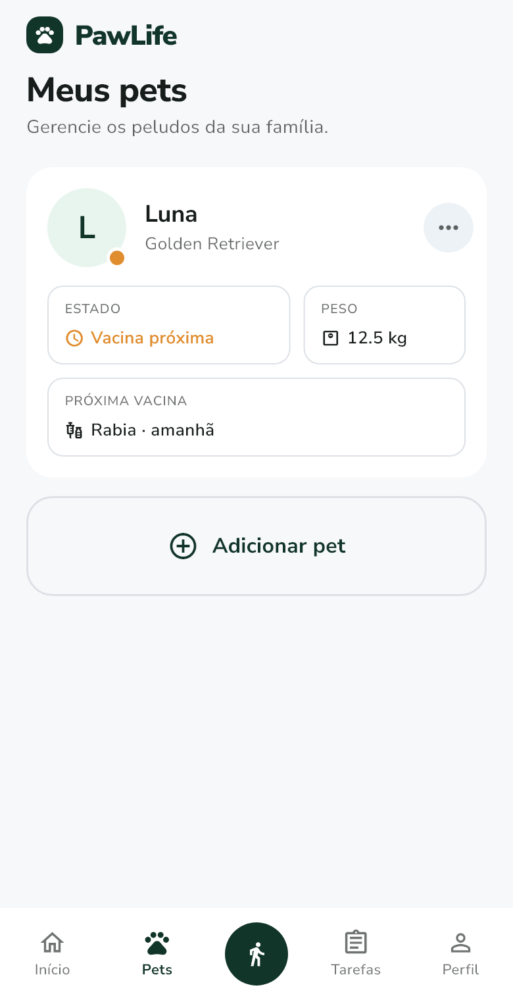 |

| Passeios | Peso | Premium |
| :---: | :---: | :---: |
| 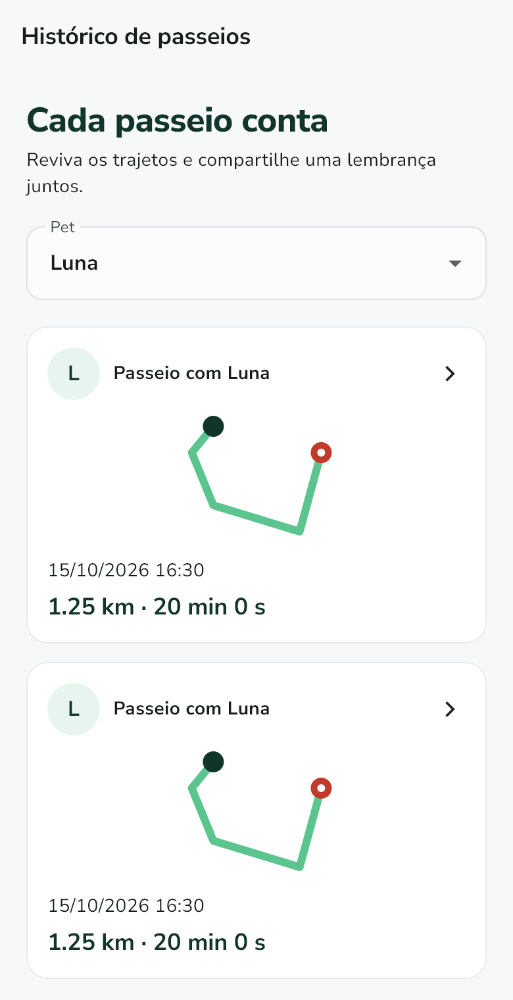 | 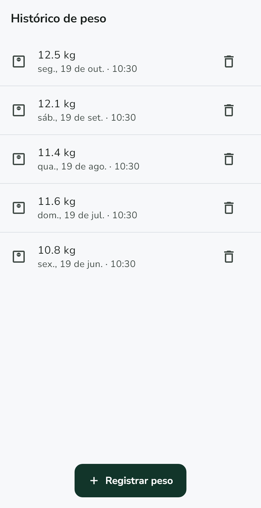 | 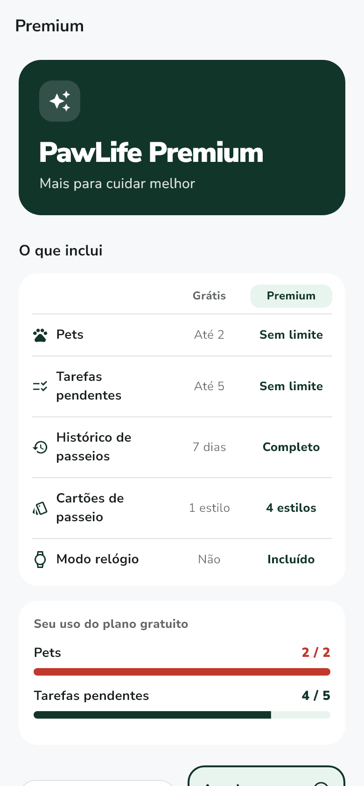 |

**Cartões do passeio**

| Bosque | Menta | Cifras | Candy |
| :---: | :---: | :---: | :---: |
| 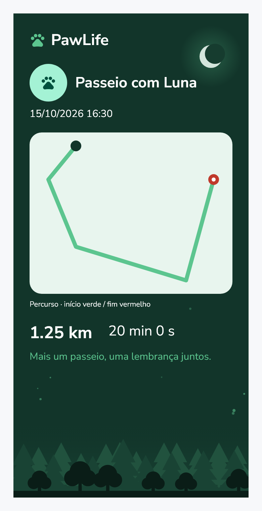 | 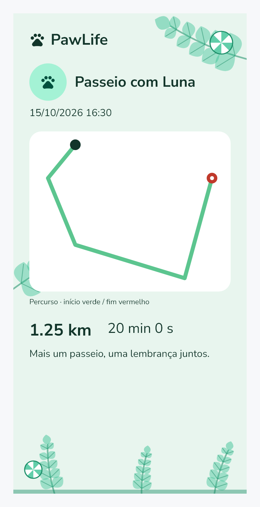 | 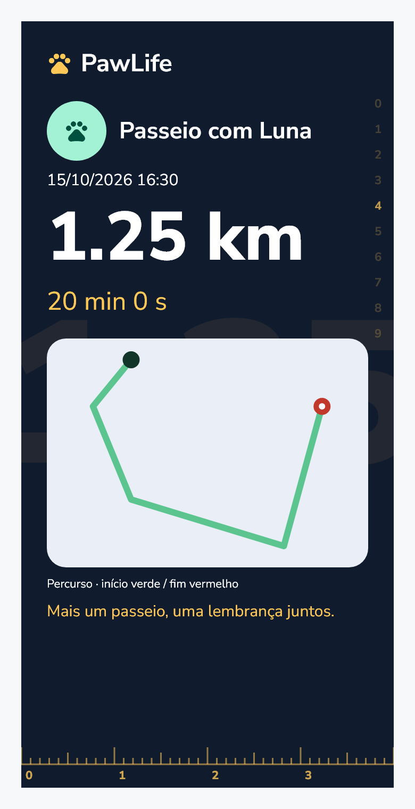 | 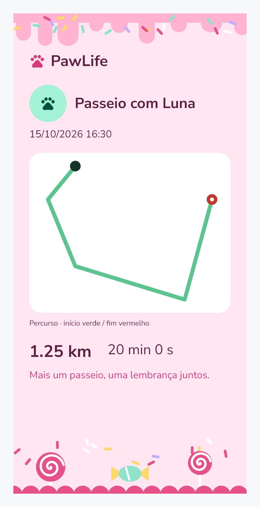 |

**Modo relógio**

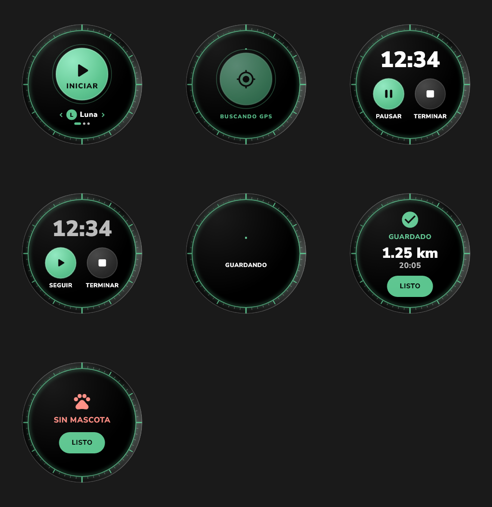

**Seletores de data e hora**

| Data | Hora |
| :---: | :---: |
| 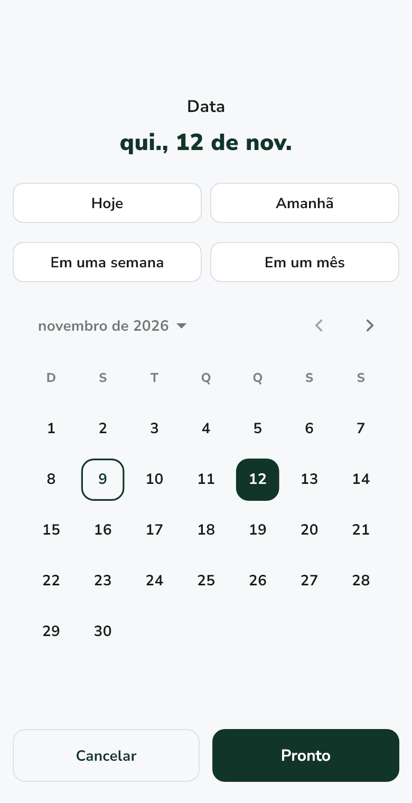 | 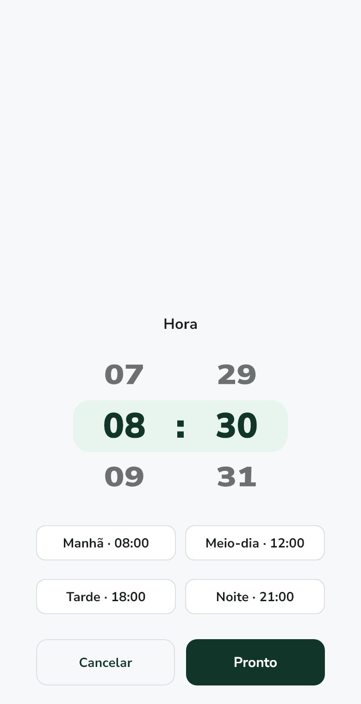 |

## Arquitetura

```
Flutter  ──HTTP + ID token──▶  API PHP (Vercel)  ──REST──▶  Firestore
   │
   └── Firebase Auth (apenas para identificar a pessoa)
```

O app **não** fala com o Firestore. O `firebase_auth` emite um ID token, que viaja em cada requisição e é
verificado pelo backend para saber de quem são os dados. Na prática:

- Não adicione `cloud_firestore` de volta: os dados são pedidos à API.
- Os modelos (`lib/models/pawlife_models.dart`) são Dart puro, com `fromJson`/`toJson` e datas em ISO 8601.
- Não há streams em tempo real: onde antes havia um `watch…`, hoje há um `fetch…` que precisa ser chamado.

### Mapa do código

```
lib/main.dart                         Inicializa o Firebase; o AuthGate escolhe a tela raiz.
lib/models/                           Modelos de domínio e o ponto de rota GPS.
lib/services/                         API (api_client), repositórios, autenticação, GPS, push e lembretes.
lib/viewmodels/route_view_model.dart  Estado do passeio em andamento.
lib/views/                            Telas. widgets/ tem os componentes reutilizáveis.
lib/views/wearable/                   Modo relógio, isolado do resto do app.
lib/theme/                            Paleta, tema claro/escuro e componentes visuais.
lib/l10n/                             Textos em es/en/pt (arquivos .arb).
test/                                 Testes de unidade e de widget.
tool/                                 Utilitários: gerar ícones e a demonstração do relógio.
docs/                                 Planos, auditorias, escopo e capturas de tela.
```

O login é obrigatório e não existe sessão anônima. O `AuthGate` escuta `authStateChanges`: mostra a
`WelcomeScreen` sem sessão e a `HomeScreen` com sessão. Por isso as telas de login e cadastro não
navegam para o Início: apenas fazem `popUntil(isFirst)` e o gate, que está por baixo, já foi reconstruído.

## Tecnologias

| Área | Pacotes |
| --- | --- |
| Interface | Flutter, Material 3, `provider`, `font_awesome_flutter` |
| Autenticação e push | `firebase_core`, `firebase_auth`, `google_sign_in`, `firebase_messaging` |
| Mapas e GPS | `flutter_map` (OpenStreetMap), `geolocator`, `flutter_foreground_task` |
| Notificações locais | `flutter_local_notifications`, `timezone`, `flutter_timezone` |
| Rede e dados | `http`, `shared_preferences`, `intl` |
| Fotos e compartilhamento | `image_picker`, `image`, `share_plus` |
| Ferramentas de desenvolvimento | `flutter_launcher_icons`, `flutter_native_splash` |

## Como executar

**Pré-requisitos:** Flutter 3.x com Dart `^3.12`, um projeto Firebase com Authentication habilitado e o
backend `apipaw` no ar.

```bash
flutter pub get
flutter run --dart-define=PAWLIFE_API_URL=https://seu-projeto.vercel.app
```

Sem `--dart-define`, usa-se o valor padrão de `ApiClient.defaultBaseUrl`
(`lib/services/api_client.dart`). Contra um backend local (`php -S localhost:8000 api/index.php` dentro de
`../apipaw`), lembre que `localhost` no emulador Android é o próprio emulador:

```bash
# Android (emulador)
flutter run --dart-define=PAWLIFE_API_URL=http://10.0.2.2:8000
# iOS (simulador)
flutter run --dart-define=PAWLIFE_API_URL=http://localhost:8000
```

Falar com um backend local por HTTP sem TLS exige permitir tráfego em claro no `AndroidManifest.xml` de
debug. Em produção a URL é https e isso não é necessário.

### Configuração do Firebase e do Google Sign-In

Sem estes passos o acesso falha, e o código não consegue suprir isso:

1. **Firebase Console → Authentication → Sign-in method:** habilitar *E-mail/senha* e *Google*.
2. **Configurações do projeto → Seus apps → Android → Adicionar impressão digital:** a SHA-1 da máquina que
   compila.

   ```bash
   keytool -list -v -keystore ~/.android/debug.keystore \
           -alias androiddebugkey -storepass android -keypass android
   ```

   No Windows, se o `keytool` falhar com `MissingFormatArgumentException`, adicione
   `-J-Duser.language=en -J-Duser.country=US`.
3. **Baixar de novo o `google-services.json`** e substituir o de `android/app/`. Enquanto a SHA-1 não estiver
   registrada, o arquivo traz `"oauth_client": []` e o Google Sign-In falha com `ApiException: 10`. O arquivo
   correto tem uma entrada com `"client_type": 3`; se não tiver, passe o cliente web à mão:

   ```bash
   flutter run --dart-define=GOOGLE_SERVER_CLIENT_ID=<web client id>
   ```

Cada máquina de debug e a chave de release têm SHA-1 própria: registre todas. No **iOS** também são
necessários o `GoogleService-Info.plist` em `ios/Runner/` e o `CFBundleURLSchemes` com o
`REVERSED_CLIENT_ID` no `Info.plist`.

### Ícone e tela de carregamento nativa

As imagens vêm de `assets/icon/` (geradas por `tool/gerar_icones_test.dart`) e são aplicadas com:

```bash
flutter test tool/gerar_icones_test.dart   # só se mudar o desenho da marca
dart run flutter_launcher_icons            # ícones de Android e iOS
dart run flutter_native_splash:create      # tela de carregamento nativa
```

## Testes

```bash
flutter analyze
flutter test
```

A suíte tem mais de 170 testes (modelos, serviços, telas, acessibilidade, idiomas, responsividade e o modo
relógio). Todos usam dados simulados: **não substituem** a prova em um dispositivo físico nem contra o
Firebase real.

### Como regenerar as capturas

```bash
PAWLIFE_SCREENSHOTS=1 flutter test test/gallery_test.dart
```

Cada tela é salva em `docs/screenshots/` (português, tema claro). As grades completas, em três idiomas e
dois temas, saem em `build/test-artifacts/`.

### Demonstração do modo relógio

Para ver o relógio animado no navegador, sem login nem GPS (o passeio é simulado):

```bash
flutter run -d web-server --web-port 5006 -t tool/demo_reloj.dart
```

## Fotos dos pets

Não é preciso nenhum serviço extra: o app reduz a foto para 256 px, a codifica em base64 e a guarda como
data URI no campo `fotoUrl` do documento do pet (`lib/services/photo_service.dart`). Dezenas de KB, bem
abaixo do limite de 1 MB por documento. Não se usa o Firebase Storage porque ele exige o plano Blaze em
projetos novos. A foto viaja em cada carga da lista, por isso o tamanho importa.

## Status

Funciona e está coberto por testes locais, mas ainda **falta**:

- Provar GPS, câmera, notificações push em primeiro e segundo plano e o relógio em um **dispositivo físico**.
- Validar contra o Firebase real (envio do e-mail de verificação, exclusão completa da conta, índices e
  permissões).
- Trocar o identificador do app (`com.example.flutter_application_1`) pelo definitivo antes de publicar nas
  lojas; ele também é o nome com que o app pede o mapa ao OpenStreetMap.
- Revisão jurídica dos termos e da política de privacidade.
- Pagamentos reais: hoje a assinatura é uma simulação.

## Documentação

- [Fechamento da entrega](docs/CIERRE_ENTREGA.md) — funções, testes e pendências.
- [Escopo do projeto semestral](docs/ESCOPO_PROJETO_SEMESTRAL.md)
- [Plano de pendências e relógio](docs/PLAN_PENDIENTES_Y_RELOJ.md)
- [Plano social dos passeios](docs/PLAN_SOCIAL_PASEOS.md)
- O painel administrativo (notificações e Premium manual) fica na API: `https://apipaw.vercel.app/notificaciones`,
  e exige uma conta administradora habilitada no backend.
